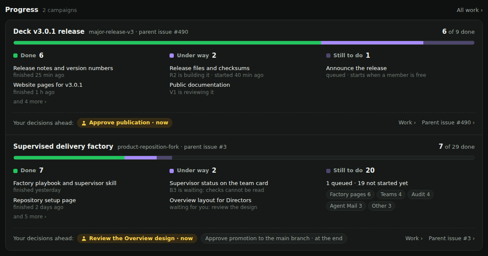
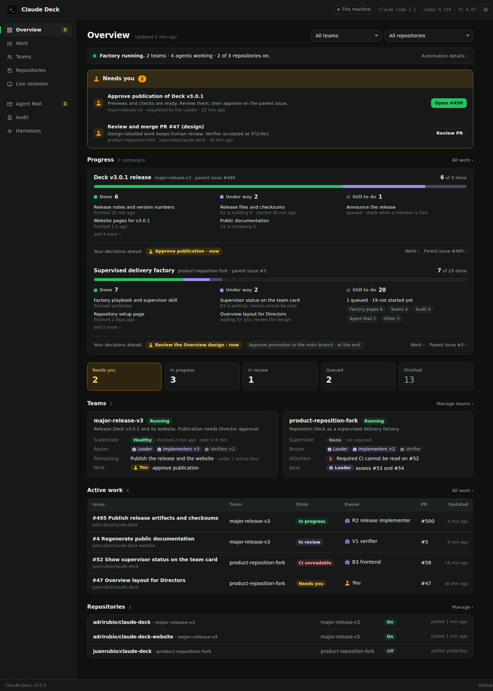

# Deck v3.1 Director UI — design reference

This folder records the target design for the Director-facing screens in the **Deck v3.1** milestone. It comes from the UI audits of 9–11 October 2026, which reviewed every screen of the running v3.0.0 instance and filed issues #507–#546.

**The issue text is authoritative.** The mockup illustrates the issues with sample data. Do not copy its numbers, and do not add behaviour that no issue describes. When the mockup and an issue disagree, follow the issue and correct the mockup.

## Contents

| File | What it is |
|---|---|
| [`director-ui-mockup.html`](director-ui-mockup.html) | Clickable mockup of all screens. Open it in a browser from a checkout. The bar at the top switches the view, the state (Needs you / Idle and paused) and the theme. |
| [`factory-operation-explainer.html`](factory-operation-explainer.html) | Explainer of the operating model: roles, hierarchy, the factory boundary, operating modes, the supervisor heartbeat, the Director's screens and what v1 leaves out. Its cards open the matching mockup views. |
| [`screens/`](screens/) | Screenshots of the mockup, one per screen and state. |
| [`explainer/`](explainer/) | Screenshots of the explainer, one per section. |

GitHub does not render the HTML files. Use the screenshots below, or open the files locally.

## Principles

| One home for | Where | Issue |
|---|---|---|
| A work item | Work (list and item page) | #533 |
| A team and its members | Teams | #542 |
| A repository and its settings | Repositories | #536 |
| An agent's state | One status, the same on every screen | #540 |
| The Director key | One dialog, asked only when needed | #518 |
| Times | One format, in local time | #521 |

Plain words first; technical details collapsed. Non-agent code does what a rule can do; agents do what needs judgment; the Director makes the retained decisions.

## Screens

| Screen | Screenshots | Issues |
|---|---|---|
| Overview | [Needs you](screens/01-overview-needs-you.png) · [Idle and paused](screens/02-overview-idle.png) · [Light theme](screens/21-overview-light.png) · [Progress card](screens/22-overview-progress.png) | #506 · #507 · #508 · #509 · #510 · #513 · #548 |
| Work | [List](screens/03-work-list.png) · [Merged item](screens/04-work-item-merged.png) · [Item that needs attention](screens/05-work-item-attention.png) | #507 · #511 · #533 · #534 |
| Teams | [Team page](screens/06-teams.png) | #542 · #543 · #544 |
| Repositories | [List](screens/07-repositories.png) · [Repository page](screens/08-repository-page.png) · [Add a repository](screens/09-add-repository.png) | #536 · #537 |
| Live sessions | [Sessions](screens/10-live-sessions.png) · [New session](screens/11-new-session.png) | #539 · #540 · #541 |
| Team lanes | [Four lanes](screens/12-team-lanes.png) · [One lane zoomed](screens/13-team-lane-zoomed.png) | #512 |
| Agent Mail | [Conversations](screens/14-agent-mail.png) · [Members](screens/15-agent-mail-members.png) | #527 · #528 · #529 · #530 · #531 |
| Audit | [Unlocked](screens/16-audit.png) · [Locked](screens/17-audit-locked.png) | #515 · #516 · #517 · #518 · #519 · #520 · #521 |
| Harnesses | [List](screens/18-harnesses.png) · [Harness page](screens/19-harness-page.png) · [Settings page](screens/20-harness-settings-page.png) | #522 · #523 · #524 · #525 · #526 · #545 |

### Progress card (added 2026-10-12)

The Overview answers three questions for each campaign: what has happened, what is happening, and what still needs to happen. One row per campaign shows:

- **Done:** the count and the latest finished items in plain titles. "Done" means merged into the campaign's branch. It does not mean closed on GitHub.
- **Under way:** each active item and its owner in plain words, for example "R2 is building it" or "waiting for you".
- **Still to do:** queued items, and items not started yet, grouped by area. They come from the campaign's milestone or parent issue.
- **Your decisions ahead:** the current Director actions, and the retained decisions that come later (for example promotion and publication).

A bar shows done, under way, queued and not started. Issues: #548 (data), #508 (Overview card), #542 (team page).

Issues without a screen: #535 (revision left active), #538 (polling after permanent errors), #546 (404 for no active project).

## Explainer

| Section | Screenshot |
|---|---|
| Introduction | [00-intro](explainer/00-intro.png) |
| 1 · The hierarchy of roles | [01](explainer/01-the-hierarchy-of-roles.png) |
| 2 · The factory and the parts around it | [02](explainer/02-the-factory-and-the-parts-around-it.png) |
| 3 · Two operating modes | [03](explainer/03-two-operating-modes.png) |
| 4 · Why the supervisor runs outside the controller | [04](explainer/04-why-the-supervisor-runs-outside.png) |
| 5 · One campaign, start to finish | [05](explainer/05-one-campaign-start-to-finish.png) |
| 6 · The optional supervisor heartbeat | [06](explainer/06-the-optional-supervisor-heartbeat.png) |
| 7 · What the Director sees | [07](explainer/07-what-the-director-sees.png) |
| 8 · Where the Director looks | [08](explainer/08-where-the-director-looks.png) |
| 9 · What v1 leaves out | [09](explainer/09-what-v1-leaves-out.png) |

The maintained operating-model documentation is [`docs/guide/operating-model.md`](../../guide/operating-model.md). This explainer is the design record behind it.
